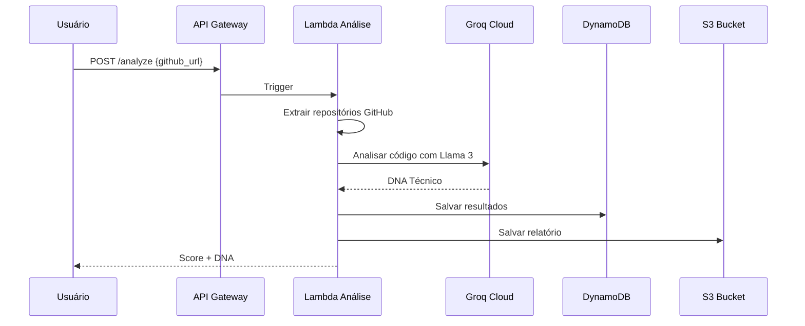
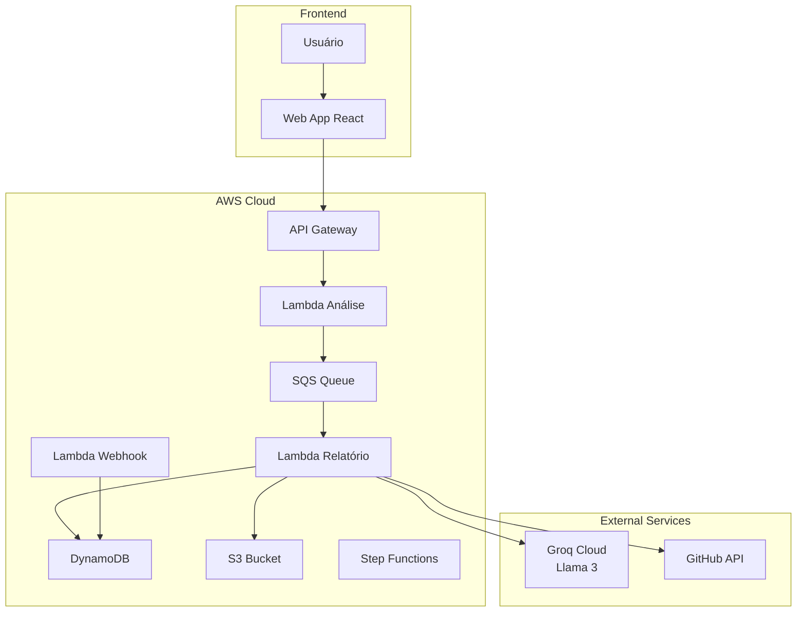
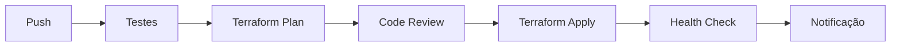

# Genefic CloudWorks


O **Genefic CloudWorks** é uma plataforma de engenharia de carreira AI-Native com arquitetura 100% serverless event-driven na AWS. O backend utiliza AWS Lambda em Python com Groq Cloud (Llama 3) para análise de repositórios GitHub, extraindo DNA técnico e gerando scores de competência.

## Índice

- [Visão Geral](#visão-geral)
- [Arquitetura de Software](#arquitetura-de-software)
- [Estrutura de Pastas](#estrutura-de-pastas)
- [Módulos e Responsabilidades](#módulos-e-responsabilidades)
- [Telas e Fluxo](#telas-e-fluxo)
- [Regras de Negócio](#regras-de-negócio)
- [Requisitos Funcionais](#requisitos-funcionais)
- [Requisitos Não Funcionais](#requisitos-não-funcionais)
- [Testes Automatizados](#testes-automatizados)
- [CI/CD](#cicd)
- [Contribuição](#contribuição)

## Visão Geral

O Genefic CloudWorks é uma plataforma AI-Native que analisa perfis de desenvolvedores GitHub para extrair o "DNA técnico" - uma composição detalhada de habilidades, tecnologias e padrões de código. A plataforma utiliza modelos de linguagem via Groq Cloud (Llama 3) para análise semântica e geração de scores de competência.

### Características Principais

- **Análise AI-Native**: Utilização de LLMs para análise profunda de código
- **Arquitetura Serverless**: 100% executado na AWS Lambda
- **Event-Driven**: Processamento assíncrono baseado em eventos
- **Infrastructure as Code**: Toda infraestrutura definida em Terraform
- **DNA Técnico**: Extração de habilidades e competências

### Fluxo do Sistema



## Arquitetura de Software

A arquitetura é baseada em eventos com comunicação assíncrona entre os componentes:

- **Ingestão**: API Gateway + Lambda
- **Processamento**: Lambda com Groq Cloud (Llama 3)
- **Armazenamento**: DynamoDB (metadados) + S3 (relatórios)
- **Orquestração**: Step Functions para workflows complexos

### Diagrama de Arquitetura



## Estrutura de Pastas

```
genefic-cloudworks/
├── infrastructure/
│   ├── main.tf                    # Configuração principal Terraform
│   ├── variables.tf               # Variáveis de entrada
│   ├── outputs.tf                 # Saídas do Terraform
│   ├── modules/
│   │   ├── lambda/
│   │   │   ├── main.tf
│   │   │   └── variables.tf
│   │   ├── dynamodb/
│   │   │   ├── main.tf
│   │   │   └── variables.tf
│   │   ├── s3/
│   │   │   ├── main.tf
│   │   │   └── variables.tf
│   │   └── apigateway/
│   │       ├── main.tf
│   │       └── variables.tf
│   └── environments/
│       ├── dev.tfvars
│       ├── staging.tfvars
│       └── prod.tfvars
├── src/
│   ├── functions/
│   │   ├── analyze/
│   │   │   ├── handler.py
│   │   │   ├── github_extractor.py
│   │   │   └── requirements.txt
│   │   ├── report/
│   │   │   ├── handler.py
│   │   │   └── report_generator.py
│   │   └── webhook/
│   │       └── handler.py
│   ├── models/
│   │   ├── developer.py
│   │   └── dna.py
│   └── utils/
│       ├── groq_client.py
│       └── github_client.py
├── tests/
│   ├── unit/
│   │   ├── test_analyze.py
│   │   └── test_report.py
│   └── integration/
│       └── test_lambda.py
├── scripts/
│   ├── deploy.sh
│   └── invoke.sh
└── README.md
```

## Módulos e Responsabilidades

| Módulo | Responsabilidade | Tecnologia |
|--------|------------------|------------|
| Analyze Function | Analisar repositórios GitHub | Python, Groq Cloud |
| Report Function | Gerar relatórios detalhados | Python, Jinja2 |
| Webhook Function | Notificar conclusão | Python, SQS |
| GitHub Client | Interagir com API GitHub | PyGithub |
| Groq Client | Interagir com Groq Cloud | httpx |

### DNA Técnico

O DNA Técnico é composto por:

| Componente | Descrição | Exemplo |
|------------|-----------|---------|
| Linguagens | Linguagens de programação utilizadas | Python, JavaScript, Go |
| Frameworks | Frameworks e bibliotecas | Django, React, FastAPI |
| Padrões | Padrões de arquitetura | REST, GraphQL, Microservices |
| Qualidade | Métricas de qualidade de código | Testes, Documentação, Code Review |
| Especialização | Áreas de conhecimento | Backend, Frontend, DevOps, ML |

## Telas e Fluxo

### Endpoint de Análise

**Request:**
```json
POST /analyze
Content-Type: application/json

{
  "github_url": "https://github.com/usuario/repositorio",
  "analysis_type": "full"
}
```

**Response:**
```json
{
  "job_id": "abc123",
  "status": "processing",
  "estimated_time": 30
}
```

### DNA Técnico Retornado

```json
{
  "developer": "usuario",
  "score": 87,
  "dna": {
    "languages": [
      {"name": "Python", "proficiency": 95, "years": 5},
      {"name": "JavaScript", "proficiency": 80, "years": 3}
    ],
    "frameworks": [
      {"name": "Django", "usage": "high"},
      {"name": "React", "usage": "medium"}
    ],
    "patterns": [
      {"name": "REST API", "frequency": "daily"},
      {"name": "Microservices", "frequency": "weekly"}
    ],
    "quality": {
      "test_coverage": 85,
      "documentation": 70,
      "code_review": 90
    }
  }
}
```

## Regras de Negócio

1. **Análise Assíncrona**: Processamentos são enfileirados e executados posteriormente
2. **Cache de Resultados**: Análises anteriores são cacheadas por 24 horas
3. **Limite de Requisições**: Máximo de 10 análises simultâneas por usuário
4. **Retenção de Dados**: Relatórios mantidos por 90 dias
5. **Privacidade**: Apenas dados públicos são analisados
6. **Uso Justo**: Limite de 100 análises por mês por conta

## Requisitos Funcionais

| ID | Requisito | Prioridade |
|----|-----------|------------|
| RF-01 | Analisar repositório GitHub | Alta |
| RF-02 | Gerar DNA técnico completo | Alta |
| RF-03 | Calcular score de competência | Alta |
| RF-04 | Gerar relatório PDF | Média |
| RF-05 | Comparar com outros perfis | Média |
| RF-06 | Histórico de análises | Média |
| RF-07 | Exportar dados em JSON | Baixa |

## Requisitos Não Funcionais

| ID | Requisito | Descrição |
|----|-----------|-----------|
| RNF-01 | Performance | Análise completa em menos de 60 segundos |
| RNF-02 | Disponibilidade | 99.9% de uptime |
| RNF-03 | Escalabilidade | Suportar 100+ análises simultâneas |
| RNF-04 | Segurança | Dados encriptados em trânsito e repouso |
| RNF-05 | Custo | Custo operacional abaixo de $50/mês |

## Testes Automatizados

### Tipos de Teste

| Tipo | Cobertura | Ferramenta |
|------|-----------|------------|
| Unitários | 90% | pytest |
| Integração | 80% | pytest + moto |
| E2E | 70% | Playwright |
| Performance | N/A | Locust |

### Comandos de Teste

```bash
# Executar todos os testes
pytest

# Com cobertura
pytest --cov=src --cov-report=html

# Testes de integração
pytest -m integration

# Testes de performance
locust -f tests/performance/locustfile.py
```

## CI/CD

| Workflow | Dispara em | O que faz |
|----------|------------|-----------|
| `test.yml` | Push/PR na main | Executa testes unitários e de integração |
| `deploy.yml` | Merge na main | Deploy via Terraform |
| `plan.yml` | PR | Plano Terraform |

### Pipeline de Deploy



## Contribuição

1. Fork o projeto
2. Crie uma branch para sua feature (`git checkout -b feature/nova-funcionalidade`)
3. Commit suas mudanças (`git commit -m 'Adiciona nova funcionalidade'`)
4. Push para a branch (`git push origin feature/nova-funcionalidade`)
5. Abra um Pull Request

### Diretrizes de Contribuição

- Siga o padrão de código Python (PEP 8)
- Escreva testes para novas funcionalidades
- Atualize a documentação quando necessário
- Mantenha a cobertura de testes acima de 80%

## Autor

**José Anderson** ([@DessimA](https://github.com/DessimA))
[LinkedIn](https://www.linkedin.com/in/dessim/) | [Website](https://jasc-dessima-dev.vercel.app/)