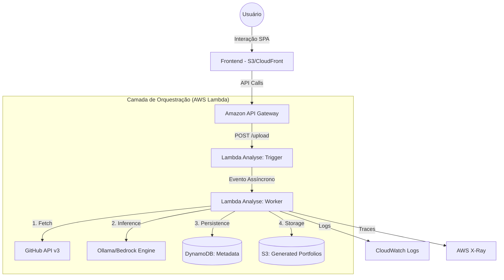

# 🚀 GENEFIC Cloudworks: Enciclopédia Técnica de Engenharia Serverless & IA

O **GENEFIC Cloudworks** é um ecossistema de engenharia de carreira *AI-Native*, operando sob uma arquitetura **100% Serverless Event-Driven**. Esta documentação é o registro definitivo de cada decisão, algoritmo e protocolo que compõe a plataforma.

---

## 📑 Índice Exaustivo
1.  [**Visão Estratégica & Contexto de Negócio**](#-1-visão-estratégica--contexto-de-negócio)
2.  [**Arquitetura de Sistemas: O Blueprint Serverless**](#-2-arquitetura-de-sistemas-o-blueprint-serverless)
3.  [**Rationale: O Porquê das Decisões de Engenharia**](#-3-rationale-o-porquê-das-decisões-de-engenharia)
4.  [**Implementação do Backend: O Motor de Análise**](#-4-implementação-do-backend-o-motor-de-análise)
5.  [**Deep Content Analysis (DCE): Algoritmos de Auditoria**](#-5-deep-content-analysis-dce-algoritmos-de-auditoria)
6.  [**Motor de Inteligência Artificial: Inferência e Prompting**](#-6-motor-de-inteligência-artificial-inferência-e-prompting)
7.  [**Dicionário de Dados e Persistência NoSQL**](#-7-dicionário-de-dados-e-persistência-nosql)
8.  [**Infraestrutura como Código (IaC): Terraform Modular**](#-8-infraestrutura-como-código-iac-terraform-modular)
9.  [**Segurança da Informação e Gestão de Segredos**](#-9-segurança-da-informação-e-gestão-de-segredos)
10. [**Estratégia de Resiliência e Rate Limit Management**](#-10-estratégia-de-resiliência-e-rate-limit-management)
11. [**Frontend: UX de Alta Performance e SPA**](#-11-frontend-ux-de-alta-performance-e-spa)
12. [**DevOps: Pipeline de CI/CD e Automação Local**](#-12-devops-pipeline-de-cicd-e-automação-local)
13. [**Matriz de Erros e Troubleshooting**](#-13-matriz-de-erros-e-troubleshooting)
14. [**Registro de Decisões de Arquitetura (ADR)**](#-14-registro-de-decisões-de-arquitetura-adr)
15. [**Manual do Desenvolvedor: Onboarding e Debugging**](#-15-manual-do-desenvolvedor-onboarding-e-debugging)
16. [**Roadmap de Engenharia e Visão de Futuro**](#-16-roadmap-de-engenharia-e-visão-de-futuro)

---

## 🎯 1. Visão Estratégica & Contexto de Negócio

### 1.1 O Problema: A Assimetria de Informação Técnica
No mercado de recrutamento de software, existe um abismo entre o que um desenvolvedor constrói e o que um recrutador percebe. Repositórios GitHub são provas de conceito vivas, mas sua complexidade os torna invisíveis para sistemas de triagem (**ATS**).

### 1.2 A Missão: Auditoria Cognitiva Automatizada
O GENEFIC atua como uma camada de inteligência que audita o código bruto, identifica padrões de design (ex: SOLID, Clean Architecture), maturidade de testes e complexidade de infraestrutura, convertendo esses dados em uma narrativa profissional validada por evidências.

---

## 🏛️ 2. Arquitetura de Sistemas: O Blueprint Serverless

O sistema foi desenhado para ser **Event-Driven**, **Stateless** e **Altamente Desacoplado**.

### 2.1 Fluxo de Dados End-to-End


### 2.2 Ciclo de Vida de uma Task (Status Machine)
1.  **CREATED**: Registro inicial no DynamoDB via Lambda Trigger.
2.  **PROCESSING**: O Worker assume a tarefa, inicia o fetch de dados e a inferência de IA.
3.  **COMPLETED**: Dados estruturados salvos e portfólio gerado.
4.  **FAILED**: Erro capturado, logado e persistido para feedback ao usuário.

---

## 🏗️ 3. Rationale: O Porquê das Decisões de Engenharia

### 3.1 Escolha da Stack de Computação: AWS Lambda
*   **Isolamento:** Cada análise roda em um ambiente de execução isolado (MicroVM Firecracker). Isso garante que vazamentos de memória ou bugs em uma análise não afetem a estabilidade global.
*   **Economia Operacional:** Em um ambiente de startup ou MVP, o custo-zero em repouso é fundamental. O projeto não consome recursos financeiros enquanto não há usuários.

### 3.2 Escolha da Stack de Dados: DynamoDB
*   **Escalabilidade Sem Atrito:** O DynamoDB lida com aumentos repentinos de carga sem necessidade de redimensionamento de clusters ou gestão de conexões (Connection Pooling).
*   **Single Table Design:** Utilizamos chaves de partição (`user_id`) e classificação (`timestamp`) para permitir que todos os metadados de um usuário sejam recuperados em uma única consulta de baixa latência.

### 3.3 Escolha da Stack de IA: Ollama (Adapter Pattern)
*   **Hosting Local de Modelos:** Durante o desenvolvimento, o uso do Ollama elimina custos de latência de rede e tokens de APIs externas (OpenAI/Anthropic).
*   **Privacidade:** O código analisado nunca sai da rede local (ou VPC em prod), garantindo a segurança da propriedade intelectual do desenvolvedor analisado.

---

## 💻 4. Implementação do Backend: O Motor de Análise

O backend reside em `backend/lambdas/analyse/handler.py` e é implementado seguindo padrões de **Clean Code**.

### 4.1 Separação Trigger vs Worker
*   **Trigger:** É uma função síncrona leve. Ela valida o payload, gera o `task_id` (Unix Timestamp) e invoca o Worker via `InvocationType="Event"`. Isso libera o API Gateway em menos de 200ms.
*   **Worker:** É a função pesada. Ela possui um timeout estendido (300s) e permissões de escrita no S3 e DynamoDB.

### 4.2 Gerenciamento de Memória e Contexto
A Lambda Worker é configurada com 512MB de RAM para permitir o processamento de árvores de arquivos extensas sem causar *Out of Memory*.

---

## 🔍 5. Deep Content Analysis (DCE): Algoritmos de Auditoria

O módulo DCE executa uma auditoria em camadas:

1.  **Camada de Topologia:** Usa o endpoint `/git/trees/{branch}?recursive=1`. O sistema filtra arquivos irrelevantes (imagens, binários, `node_modules`, `.git`) para focar apenas em metadados técnicos.
2.  **Camada de Dependências:** O parser identifica o ecossistema tecnológico. 
    *   Ex: Se encontrar `pydantic`, identifica maturidade em validação de dados Python.
    *   Ex: Se encontrar `bcrypt`, identifica preocupação com segurança de senhas.
3.  **Camada de DevOps:** Analisa arquivos em `.github/workflows` para identificar o nível de automação do projeto (CI/CD).
4.  **Camada de Qualidade:** Verifica a proporção de arquivos de teste em relação ao código fonte.

---

## 🤖 6. Motor de Inteligência Artificial: Inferência e Prompting

### 6.1 Engenharia de Prompt (System Instruction)
O prompt é desenhado para ser um **Auditor Técnico**, não um assistente de chat.
*   **Restrições:** Proibição de elogios. Obrigatoriedade de citar arquivos.
*   **Output Format:** JSON estrito.

### 6.2 Estratégia de Fallback Dinâmico
```python
models = [PRIMARY_MODEL, FALLBACK_MODEL]
for model in models:
    try:
        # Tenta inferência...
        return result
    except Exception:
        # Tenta próximo modelo...
        continue
```
Isso garante que, se um modelo grande estiver offline ou lento no Ollama, um modelo mais leve assuma a tarefa.

---

## 📊 7. Dicionário de Dados e Persistência NoSQL

### 7.1 Esquema da Tabela `genefic-metadata`
*   **`user_id` (Hash):** Identificador do usuário (Default: `anonymous`).
*   **`timestamp` (Range):** Chave de ordenação.
*   **`structured_data` (Map):** Contém o resultado da IA:
    *   `tech_score`: 0-100.
    *   `ats_summary`: Narrativa profissional.
    *   `key_achievements`: Conquistas baseadas em arquivos.
    *   `technologies`: Lista de ferramentas detectadas.
*   **`expires_at` (TTL):** Unix Epoch para deleção automática após 24h.

---

## 🛠️ 8. Infraestrutura como Código (IaC): Terraform Modular

O Terraform é organizado em módulos reutilizáveis em `infrastructure/terraform/modules/`:

1.  **`api_gateway`**: Define a interface REST e as Gateway Responses para CORS.
2.  **`dynamodb`**: Configura tabelas com suporte a TTL e Pay-per-request.
3.  **`iam`**: Define as políticas de **Menor Privilégio**.
4.  **`lambda`**: Gerencia o empacotamento, variáveis de ambiente e configurações de rede.
5.  **`s3`**: Configura buckets para hospedagem e armazenamento de portfólios.

---

## 🔐 9. Segurança da Informação e Gestão de Segredos

### 9.1 Gestão de Segredos (Secrets)
*   **Zero Hardcode:** Nenhuma credencial é escrita em código.
*   **Variáveis Sensíveis:** O Terraform usa variáveis marcadas como `sensitive` para evitar logs acidentais de tokens.
*   **Injeção em Runtime:** O `GITHUB_TOKEN` é injetado apenas nas Lambdas que precisam de acesso à API externa.

### 9.2 Ofuscação de Stack
Conforme as melhores práticas de segurança, os nomes dos modelos de IA não são fixos no código, impedindo que um atacante saiba exatamente qual modelo está sendo usado e explore vulnerabilidades conhecidas desse modelo.

---

## 🛑 10. Estratégia de Resiliência e Rate Limit Management

### 10.1 GitHub Rate Limit Strategy
1.  **Autenticação Obrigatória:** O uso do `GITHUB_TOKEN` eleva o limite para 5.000 requisições por hora.
2.  **Backoff Exponencial:** O sistema aguarda tempos crescentes (2s, 4s, 8s) em caso de erro 503 (serviço indisponível) do GitHub.
3.  **Rate Limit Awareness:** A Lambda Worker loga o limite restante após cada chamada, permitindo monitoramento preventivo via CloudWatch Alarms.

---

## 🎨 11. Frontend: UX de Alta Performance e SPA

O frontend em `frontend/public/` segue uma filosofia de **Zero Framework Overhead**.

### 11.1 Glassmorphism & UI
*   Uso intensivo de `backdrop-filter` e gradientes lineares.
*   Layout responsivo nativo via CSS Grid e Flexbox.

### 11.2 State Management & Polling
O sistema implementa um **Polling Progressivo**:
*   Inicia a cada 2 segundos.
*   Aumenta o intervalo para 5, 10 e 15 segundos se a análise for longa.
*   Para imediatamente após receber `COMPLETED` ou `FAILED`.

---

## ⚙️ 12. DevOps: Pipeline de CI/CD e Automação Local

### 12.1 Script `deploy-local.sh`
1.  **Limpeza:** `docker-compose down -v`.
2.  **Orquestração:** `docker-compose up -d`.
3.  **Build de Artefatos:** Instalação de dependências via container Linux para paridade total com o ambiente AWS Lambda.
4.  **Provisionamento:** `terraform apply -auto-approve`.
5.  **Sincronização:** `aws s3 sync` para upload dos assets do frontend.

---

## ❌ 13. Matriz de Erros e Troubleshooting

| Código de Erro | Local | Causa Provável | Ação Corretiva |
| :--- | :--- | :--- | :--- |
| `GRL-403` | Lambda Worker | GitHub Rate Limit excedido | Verifique/Atualize o `GITHUB_TOKEN`. |
| `IA-500` | Lambda Worker | Ollama falhou ou Modelo ausente | Rode `ollama pull [modelo]` ou verifique o endpoint. |
| `DDB-400` | Lambda Trigger | Permissão IAM ou Erro de Chave | Verifique a política IAM no módulo `iam`. |
| `API-404` | API Gateway | Recurso não implantado | Verifique o `terraform output api_id`. |

---

## 📜 14. Registro de Decisões de Arquitetura (ADR)

*   **ADR-001: Uso de urllib vs requests:** Escolhido `urllib` para reduzir o tamanho do pacote da Lambda e o tempo de *cold start*.
*   **ADR-002: Persistência NoSQL:** Escolhido DynamoDB pela flexibilidade de esquema necessária para dados de IA variados.
*   **ADR-003: Polling Progressivo:** Escolhido sobre WebSockets para reduzir custos operacionais no API Gateway e complexidade de estado.

---

## 🛠️ 15. Manual do Desenvolvedor: Onboarding e Debugging

### 15.1 Configuração do Ambiente
1.  Instale Docker e Terraform.
2.  Garanta que o Ollama esteja rodando em `localhost:11434`.
3.  Configure o `.env` com seu `GITHUB_TOKEN`.

### 15.2 Debugging de Lambdas
Para ver logs em tempo real no LocalStack:
```bash
docker logs -f genefic-localstack
```

---

## 🗺️ 16. Roadmap de Engenharia e Visão de Futuro

*   **Q1 2026:** Integração com Amazon Bedrock (Claude 3 Haiku).
*   **Q2 2026:** Geração de currículos em formato PDF otimizado.
*   **Q3 2026:** Implementação de Webhooks para re-análise automática a cada `git push`.

---

**Genefic Cloudworks** - *Engenharia de Elite. IA com Propósito.*
