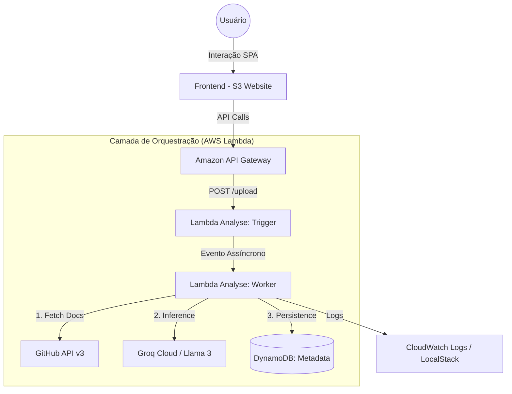

# 🚀 GENEFIC Cloudworks: Enciclopédia Técnica de Engenharia Serverless & IA

O **GENEFIC Cloudworks** é um ecossistema de engenharia de carreira *AI-Native*, operando sob uma arquitetura **100% Serverless Event-Driven**. Esta documentação é o registro definitivo de cada decisão, algoritmo e protocolo que compõe a plataforma.

---

## 📑 Índice Exaustivo
1.  [**Visão Estratégica & Contexto de Negócio**](#-1-visão-estratégica--contexto-de-negócio)
2.  [**Arquitetura de Sistemas: O Blueprint Serverless**](#-2-arquitetura-de-sistemas-o-blueprint-serverless)
3.  [**Rationale: O Porquê das Decisões de Engenharia**](#-3-rationale-o-porquê-das-decisões-de-engenharia)
4.  [**Implementação do Backend: O Motor de Análise**](#-4-implementação-do-backend-o-motor-de-análise)
5.  [**Deep Content Analysis (DCA): Algoritmos de Auditoria**](#-5-deep-content-analysis-dca-algoritmos-de-auditoria)
6.  [**Motor de Inteligência Artificial: Inferência e Prompting**](#-6-motor-de-inteligência-artificial-inferência-e-prompting)
7.  [**Dicionário de Dados e Persistência NoSQL**](#-7-dicionário-de-dados-e-persistência-nosql)
8.  [**Infraestrutura como Código (IaC): Terraform Modular**](#-8-infraestrutura-como-código-iac-terraform-modular)
9.  [**Segurança da Informação e Gestão de Segredos**](#-9-segurança-da-informação-e-gestão-de-segredos)
10. [**Estratégia de Resiliência e Rate Limit Management**](#-10-estratégia-de-resiliência-e-rate-limit-management)
11. [**Frontend: UX de Alta Performance e SPA**](#-11-frontend-ux-de-alta-performance-e-spa)
12. [**DevOps: Pipeline de CI/CD e Automação Local**](#-12-devops-pipeline-de-cicd-e-automação-local)
13. [**Matriz de Erros e Troubleshooting**](#-13-matriz-de-erros-e-troubleshooting)
14. [**Manual do Desenvolvedor: Onboarding e Debugging**](#-14-manual-do-desenvolvedor-onboarding-e-debugging)
15. [**Roadmap de Engenharia e Visão de Futuro**](#-15-roadmap-de-engenharia-e-visão-de-futuro)

---

## 🎯 1. Visão Estratégica & Contexto de Negócio

### 1.1 O Problema: A Assimetria de Informação Técnica
No mercado de recrutamento de software, existe um abismo entre o que um desenvolvedor constrói e o que um recrutador percebe. Repositórios GitHub são provas de conceito vivas, mas sua complexidade os torna invisíveis para sistemas de triagem (**ATS**).

### 1.2 A Missão: Auditoria Cognitiva Automatizada
O GENEFIC atua como uma camada de inteligência que audita o código bruto, identifica padrões de design (ex: SOLID, Clean Architecture), maturidade de testes e complexidade de infraestrutura, convertendo esses dados em uma narrativa profissional validada por evidências técnicas reais.

---

## 🏛️ 2. Arquitetura de Sistemas: O Blueprint Serverless

O sistema foi desenhado para ser **Event-Driven**, **Stateless** e **Altamente Desacoplado**.

### 2.1 Fluxo de Dados End-to-End


### 2.2 Ciclo de Vida de uma Task (Status Machine)
1.  **PROCESSING**: Registro inicial no DynamoDB. O Worker assume a tarefa e inicia o fetch.
2.  **COMPLETED**: Análise concluída, JSON estruturado e Score gerado.
3.  **FAILED**: Erro capturado (ex: Rate Limit, Timeout ou IA) e persistido para feedback.

---

## 🏗️ 3. Rationale: O Porquê das Decisões de Engenharia

### 3.1 Escolha da Stack de Computação: AWS Lambda
*   **Isolamento:** Cada análise roda em um ambiente de execução isolado.
*   **Performance:** Configurada com **256MB** para equilibrar custo e velocidade de processamento de contexto de IA.

### 3.2 Escolha da Stack de Dados: DynamoDB
*   **Single Table Design:** Chaves `user_id` e `timestamp` permitem recuperação instantânea do histórico de análises.
*   **TTL (Time to Live):** Metadados temporários expiram automaticamente, reduzindo custos de armazenamento.

### 3.3 Escolha da Stack de IA: Groq Cloud (Llama 3.3)
*   **Baixa Latência:** A Groq oferece a inferência mais rápida do mercado, essencial para um feedback de UX em tempo real.
*   **Capacidade de Contexto:** Permite analisar múltiplos arquivos (README, Pom.xml, etc.) simultaneamente sem degradação de performance.
*   **Fallback Strategy:** Alternância automática entre modelos `versatile` e `instant`.

---

## 💻 4. Implementação do Backend: O Motor de Análise

### 4.1 Separação Trigger vs Worker
*   **Trigger:** Valida a URL do GitHub e agenda o trabalho. Retorna `202 Accepted` imediatamente.
*   **Worker:** Executa a extração densa (`fetch_docs`) e a auditoria de IA.

### 4.2 Lazy Initialization
Os clientes AWS e Groq são inicializados apenas sob demanda (padrão *Singleton/Lazy*), otimizando o tempo de *Cold Start* da Lambda.

---

## 🔍 5. Deep Content Analysis (DCA): Algoritmos de Auditoria

O motor de auditoria não olha apenas nomes de arquivos, ele extrai o DNA técnico:

1.  **Mapeamento de Estrutura:** Analisa a árvore completa do repo (até 100 caminhos).
2.  **Extração Prioritária (DCA v2):** Captura até 8 arquivos críticos incluindo:
    *   **Java/Spring:** `pom.xml`, `build.gradle`, `application.yml`.
    *   **Node/Python:** `package.json`, `requirements.txt`.
    *   **Infra:** `Dockerfile`, `docker-compose.yml`.
3.  **Análise de Documentação:** Lê até 4000 caracteres do `README.md` para entender a proposta de valor do projeto.

---

## 🤖 6. Motor de Inteligência Artificial: Auditoria Técnica

### 6.1 Auditor System Prompt
O motor da Groq opera sob o modo **'GENEFIC AUDITOR'**:
*   **Fato vs Sugestão:** Se uma tecnologia já está no código, a IA é proibida de sugeri-la como melhoria.
*   **Evidências:** Cada conquista deve ser baseada em um arquivo ou trecho detectado.
*   **JSON Only:** Resposta pura em JSON, sem formatação Markdown para integração direta com o frontend.

---

## 📊 7. Dicionário de Dados

### 7.1 Esquema `genefic-local-metadata`
*   **`tech_score`**: 0-100 (Rubrica baseada em complexidade e maturidade).
*   **`ats_summary`**: Narrativa profissional densa para cargos Senior/Staff.
*   **`key_achievements`**: Lista de conquistas comprovadas.
*   **`improvements`**: Melhorias reais que ainda não foram implementadas.

---

## 🛠️ 8. Infraestrutura como Código (IaC)

Organização modular em Terraform:
*   **`api_gateway`**: Interface REST com CORS e Gateway Responses resilientes.
*   **`lambda`**: Gestão de lifecycle, empacotamento automatizado e injeção de env vars.
*   **`dynamodb`**: Tabelas NoSQL com auto-scaling simulado via LocalStack.

---

## 🛑 9. Estratégia de Resiliência

### 9.1 GitHub Rate Limit
*   **Token-Aware:** O uso do `GITHUB_TOKEN` eleva o limite para 5.000 req/h.
*   **Retry Logic:** Backoff exponencial para erros temporários do GitHub (502/503/504).

---

## ⚙️ 10. DevOps: Automação Local

### 10.1 Script `deploy-local.sh`
O pipeline local automatiza:
1.  Limpeza completa do ambiente (`.localstack` e `terraform.tfstate`).
2.  Orquestração via `docker-compose`.
3.  Packaging da Lambda com `chmod` recursivo para permissões de runtime.
4.  Apply do Terraform e Sync do S3 Website.
5.  **Teste de Consistência:** Execução do script `verify_consistency.py` para validar a API.

---

## ❌ 11. Matriz de Erros

| Código | Descrição | Ação |
| :--- | :--- | :--- |
| `IA-500` | Falha na Inferência Groq | Verifique a validade da `GROQ_API_KEY`. |
| `GRL-403` | GitHub Rate Limit | Configure um novo Token clássico no `.env`. |
| `502 Bad Gateway` | Crash na Lambda | Verifique os logs: `docker logs genefic-localstack`. |

---

## 🛠️ 12. Manual do Desenvolvedor

### 12.1 Pré-requisitos
*   Docker & Docker Compose.
*   Terraform (v1.5+).
*   Conta na [Groq Cloud](https://console.groq.com/) para obter a API Key.

### 12.2 Configuração (.env)
```bash
GROQ_API_KEY=gsk_...
GITHUB_TOKEN=ghp_...
PRIMARY_MODEL=llama-3.3-70b-versatile
FALLBACK_MODEL=llama-3.1-8b-instant
```

### 12.3 Debugging Proativo
Para monitorar a Lambda em tempo real:
```bash
docker logs -f genefic-localstack
```

---

**Genefic Cloudworks** - *Engenharia de Elite. Auditoria com Propósito.*
