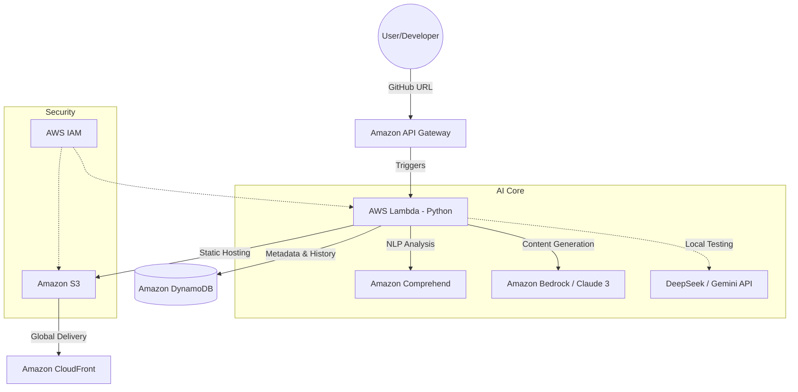

# GENEFIC Cloudworks ☁️🤖

**Intelligent Professional Narrative Platform for Aspiring Developers**

GENEFIC Cloudworks is a high-performance, AI-driven serverless platform designed to bridge the gap between technical code and business value. It transforms raw GitHub repositories into compelling professional narratives, optimized for Applicant Tracking Systems (ATS) and human recruiters.

## 🏗️ System Architecture

Built with a 100% cloud-native approach on AWS, ensuring scalability, security, and cost-efficiency.



## 🌟 Key Features

- **Strategic ATS Optimization**: Automatic identification of critical keywords within your source code to bypass automated screening filters.
- **Authority Tech Score**: An impartial evaluation of technical complexity, documentation quality, and project completeness (CI/CD, Tests, Deploy).
- **Business Value Narrative**: Translates complex architectural decisions into accessible business language, explaining the *why* behind technology choices.
- **Glassmorphism UI/UX**: A premium, responsive interface featuring dynamic themes (Light/Dark) and professional iconographic design.
- **Cloud-Native Automation**: Automated local deployment using LocalStack for zero-cost functional testing.

## 🛠️ Tech Stack

| Layer | Technologies |
| :--- | :--- |
| **Frontend** | Vanilla JS (ES6+), CSS3 (Glassmorphism), Font Awesome 6 |
| **Backend** | AWS Lambda (Python 3.11), REST API (OpenAI API Compatible) |
| **Database** | Amazon DynamoDB (NoSQL with TTL) |
| **Infra (IaC)** | Terraform |
| **AI/ML** | Amazon Bedrock (Claude 3), Comprehend, DeepSeek, Gemini |
| **DevOps** | Docker, LocalStack, GitHub Actions |

## 🚀 Getting Started

### Prerequisites
- **Docker** & **Docker Compose**
- **DeepSeek** or **Gemini** API Key (for local testing)

### Installation
1. **Clone the Repository:**
   ```bash
   git clone https://github.com/your-username/genefic-cloudworks.git
   cd genefic-cloudworks
   ```
2. **Configure Environment:**
   ```bash
   cp .env.example .env
   # Fill in your AI_PROVIDER and API_KEY
   ```
3. **Deploy Locally:**
   ```bash
   ./automation/deploy-local.sh
   ```

## ⚙️ Automation Scripts (`/automation`)

| Script | Purpose |
| :--- | :--- |
| `deploy-local.sh` | Full local deployment: provisions LocalStack, builds Lambda, and injects frontend config. |
| `tests.sh` | Executes unit and integration tests using `pytest` and `moto`. |
| `deploy.sh` | Production deployment script for AWS real environments. |
| `destroy.sh` | Full cleanup of containers, volumes, and Terraform state. |

## 👥 The Minds Behind GENEFIC

- **Emanuel Heráclio**: Product Owner
- **Cynthia Borelli**: Scrum Master
- **Edivaldo Junior**: Tech Lead
- **Gabriel Araújo**: Full Stack Dev
- **Anderson Costa**: Backend Dev
- **Naiara Oliveira**: Frontend Dev

---
*Developed as the Final Project for the AWS re/Start + AI Program - Escola da Nuvem.*
